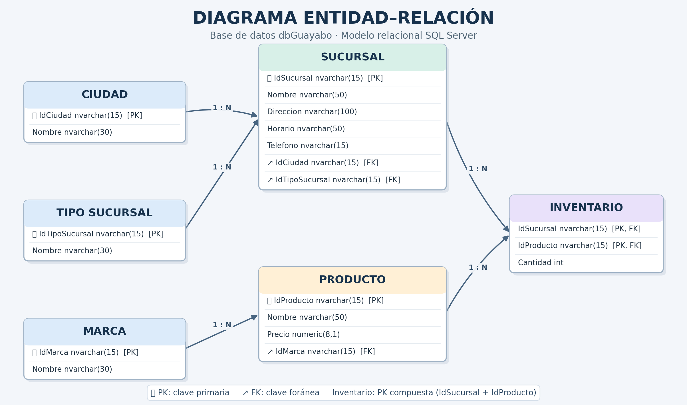

# README
# # 🏪 dbLicorera — Sistema de gestión de inventario

Proyecto académico de diseño e implementación de una base de datos relacional para una licorera, desarrollado con SQL Server.

El sistema permite organizar y consultar información de productos, marcas, sucursales, ciudades e inventarios, aplicando conceptos de modelado relacional, integridad referencial y programación en SQL.

Actualmente, el proyecto también contempla el aprendizaje y la exploración de la adaptación del modelo relacional a MongoDB.

---

## 📊 Diagrama entidad-relación

El siguiente diagrama representa la estructura de la base de datos y las relaciones entre sus entidades.

## 🗄️ Estructura de la base de datos

El modelo relacional está compuesto por seis tablas:

| Tabla | Descripción |
|---|---|
| `Ciudad` | Almacena las ciudades donde se encuentran las sucursales. |
| `TipoSucursal` | Clasifica las sucursales según su tipo. |
| `Marca` | Registra las marcas de los productos. |
| `Producto` | Almacena los productos, sus precios y marcas. |
| `Sucursal` | Contiene la información de las sucursales. |
| `Inventario` | Relaciona los productos con las sucursales y registra sus cantidades. |

La tabla `Inventario` utiliza una clave primaria compuesta por `IdSucursal` e `IdProducto`, evitando registrar dos veces el mismo producto para una misma sucursal.

## ⚙️ Funcionalidades implementadas

### Vistas (Views)

Se desarrollaron dos vistas para facilitar la consulta de información:

- **`vwDetalleInventario`:** reúne información de ciudades, tipos de sucursal, sucursales, productos, marcas y cantidades disponibles.
- **`vwProductosDisponibles`:** muestra los productos registrados en los inventarios de las sucursales, filtrando aquellos cuya cantidad es mayor que cero.

### Procedimientos almacenados (Stored Procedures)

El proyecto incluye tres procedimientos:

- **`spListInventoryxSucursal`:** consulta los productos y sus cantidades para una sucursal específica y verifica que esta exista.
- **`spAddProducto`:** permite registrar productos, comprobando que el identificador no esté repetido y que la marca exista.
- **`spCountProductsxSucursal`:** calcula la cantidad de productos registrados en el inventario de una sucursal mediante un parámetro de salida.

### Triggers

Se implementaron dos triggers:

- **`trgAddProducto`:** se ejecuta después de insertar un producto y permite consultar los registros insertados.
- **`trgAddInventario`:** utiliza la operación `INSTEAD OF INSERT` para validar la existencia de la sucursal y del producto, y comprobar que la combinación no esté registrada previamente antes de insertar.

## 🛠️ Tecnologías y herramientas

- **Microsoft SQL Server:** creación, estructuración y gestión de la base de datos.
- **SQL:** consultas, relaciones, vistas, procedimientos almacenados y triggers.
- **MongoDB Compass:** herramienta utilizada en el proceso de aprendizaje y exploración de la adaptación del modelo a MongoDB.
- **Git y GitHub:** almacenamiento y seguimiento de los cambios del proyecto.

## 📚 Conceptos aplicados

- Diseño y modelado de bases de datos relacionales.
- Relaciones uno a muchos (1:N).
- Claves primarias (PK) y claves foráneas (FK).
- Claves primarias compuestas.
- Integridad referencial.
- Normalización de datos hasta tercera forma normal (3FN).
- Consultas SQL con `INNER JOIN`.
- Vistas y procedimientos almacenados.
- Triggers y validación de operaciones.

## 🚀 Instalación y ejecución

Para ejecutar el proyecto se necesita una instancia de Microsoft SQL Server y una herramienta para ejecutar consultas SQL, como SQL Server Management Studio (SSMS).

1. Clonar o descargar este repositorio.
2. Abrir el archivo `LicoreraBD.sql` en SQL Server Management Studio.
3. Ejecutar el script completo.
4. Verificar la creación de las tablas y los registros de prueba.
5. Consultar las vistas y ejecutar los procedimientos almacenados incluidos en el archivo.

**Nota:** el repositorio se llama `dbLicorera`, mientras que el script crea la base de datos con el nombre `dbGuayabo`.

## 📌 Estado del proyecto

**En desarrollo.**

La implementación relacional en SQL Server cuenta con su estructura, datos de prueba, vistas, procedimientos almacenados y triggers.

Se contempla como siguiente etapa la adaptación del modelo a MongoDB, con el objetivo de explorar las diferencias entre las bases de datos relacionales y las orientadas a documentos.

## 👨‍💻 Autor

**Nicolás Quinchia Echeverri**

Estudiante de Tecnología en Desarrollo de Software  
Institución Universitaria Pascual Bravo

Proyecto académico desarrollado como parte del proceso de formación en diseño y gestión de bases de datos.cadémicos y de aprendizaje.
